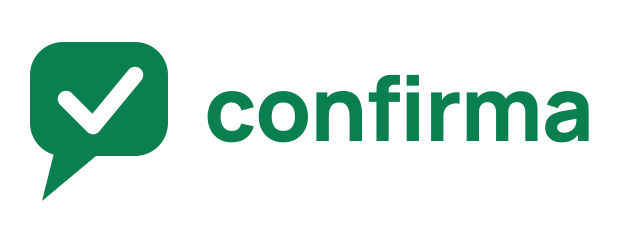

  

# Confirma

O Confirma ajuda clínicas e sistemas de gestão a confirmar agendamentos pelo
WhatsApp.

## O que é

É um serviço que conversa com o paciente para saber se ele confirma ou não um
agendamento. Depois, informa o resultado ao sistema da clínica.

O sistema integrado envia os dados do agendamento uma única vez. O Confirma
cuida do restante do fluxo: prepara a mensagem, envia pelo WhatsApp, espera a
resposta e comunica o resultado.

## Qual problema resolve

Sem o Confirma, cada sistema de clínica precisa criar e manter sua própria
solução para:

- enviar mensagens de confirmação;
- controlar o melhor momento para o envio;
- lidar com falhas e novas tentativas;
- interpretar a resposta do paciente;
- acompanhar o resultado do agendamento;
- avisar o sistema da clínica sobre o que aconteceu.

O Confirma concentra essa responsabilidade em um único serviço, reduzindo a
complexidade da integração.

## Como funciona

1. Um sistema de gestão envia um agendamento ao Confirma.
2. O Confirma valida as informações e aguarda o momento adequado.
3. Uma mensagem é enviada ao paciente pelo WhatsApp.
4. O paciente responde para confirmar ou recusar.
5. O resultado é enviado de volta ao sistema de gestão.

## Para quem é

O produto é destinado inicialmente a desenvolvedores de sistemas de gestão de
clínicas convidados para o Beta fechado.

O paciente recebe apenas uma mensagem simples de confirmação, usando dados
fictícios durante a fase atual de validação.

## Estágio atual

O Confirma está em **Beta fechado**.

Nesta etapa, o objetivo é validar o fluxo completo entre:

- o sistema de gestão da clínica;
- o Confirma;
- o paciente;
- o WhatsApp.

O produto está sendo desenvolvido de forma gradual. O acesso é restrito a
participantes convidados e o cenário atual utiliza dados fictícios para validar
a experiência ponta a ponta.

## Documentação

As especificações do produto estão em [`docs/`](docs/).
